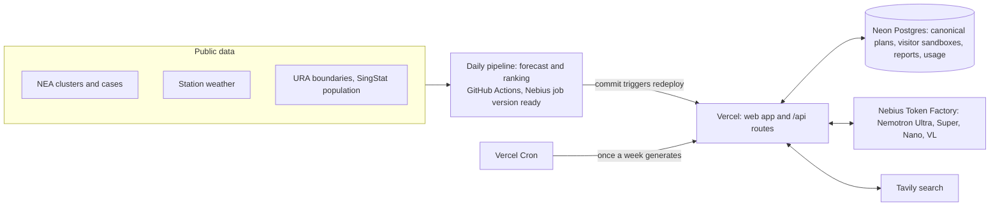

# DengueRadar Copilot

**An AI agent that runs a dengue inspection team's week, end to end.** Built for NEA vector control officers, operations planners and town council teams in Singapore. The agent plans the week from real risk rankings, adapts the plan when officers push back, guides inspectors on site, turns their rough notes into formal reports, and writes the supervisor's weekly review, using NVIDIA Nemotron models on Nebius Token Factory.

**Live app:** https://dengueradar.vercel.app

> **Student prototype, not an official NEA tool.** Plans, checklists, reports and briefings are drafted by AI and must be checked by an officer. The forecast is island-wide; the subzone ranking is a transparent rule-based index that has not yet been validated. **Premises and inspection records are demo data** (see [Demo data](#demo-data)).

## Architecture



## Who it is for and what it does

| Stage | Who | What the Copilot does |
|---|---|---|
| **1. Plan** | Operations planner | Ultra drafts the week's plan from our rankings, area history and recent news (tool calls), with a reason per area and a team per area. The officer asks *why*, or sets constraints ("only 2 teams", "skip areas inspected last week", "8 premises a day"); the agent re-plans and shows what changed. Code fits capacity and orders visits (nearest neighbour). Confirm, then assign to teams and print team sheets. |
| **2. Inspect** | Inspector on a phone | Visit list per team and day. Each premises gets a checklist tailored to its type, layout and breeding history (Nano). Notes are typed or dictated, and Super turns them into a structured service report (JSON) that the inspector edits before saving. Photos are classified by VL, with unclear ones flagged for a retake. |
| **3. Review** | Supervisor | Counts, trends against last week, overdue actions and re-inspections are computed in SQL; Super writes the briefing from those numbers. Repeat or multiple breeding at the same premises is detected in SQL, explained by Nano, and given a rule-based escalation step. |

The original DengueRadar risk map, forecast and model evaluation are still in the app under **Risk map** and **Model**.

## How we use NVIDIA Nemotron + Nebius Token Factory

All model calls go server-side through Token Factory's OpenAI-compatible API (`https://api.tokenfactory.nebius.com/v1/`), with the key in `NEBIUS_API_KEY`; it is never sent to the browser. See `api/_lib/llm.ts`.

| Model | ID | Used for | Why |
|---|---|---|---|
| Nemotron 3 Ultra | `nvidia/Nemotron-3-Ultra-550b-a55b` | Weekly plan and re-planning: tool calling (`rank_areas`, `get_area_risk`, `get_area_history`, `search_recent_context`), then a JSON decision on areas and team regions | The hardest reasoning: risk, vulnerable people, capacity and geography at once |
| Nemotron 3 Super | `nvidia/nemotron-3-super-120b-a12b` | Copilot answers (with tools), routing questions vs plan changes, notes to service report (JSON), supervisor briefing | Strong writing and reliable JSON at lower cost |
| Nemotron 3 Nano | `nvidia/NVIDIA-Nemotron-3-Nano-30B-A3B` | Site checklists, habitat-specific repeat-offender advice | Fast and cheap for short, frequent tasks on site |
| Nemotron 3.5 Super VL | `nvidia/Nemotron-3.5-Super-VL` | Photo classification (container / puddle / drain / other) and retake flags | Vision-language |

What we learned and built around:
- **Reasoning is switched off by default** (`chat_template_kwargs.enable_thinking=false`). It saved roughly 90% of tokens on short tasks. In testing, Ultra with reasoning on also invented a tool and figures for it, so the plan runs with reasoning off and unknown tool calls are rejected. Any `<think>` text is stripped before users see output.
- **Two-phase agent.** Ultra researches with tools, then makes its decision in strict JSON mode, choosing only from a candidate table built by code. Free-text final answers drifted from the format.
- **Every number is checked in code** (`api/_lib/planrender.ts`, `checks.ts`). The planner names data keys and writes number-free notes; code renders every number from that area's own data, so a figure can't land on the wrong area. Text with a stray number is removed, and the clickable "numbers checked" badge shows what was checked and corrected. Briefings use placeholders filled by code; report counts must appear in the inspector's notes; checklist claims about past breeding are checked against the premises' history.
- **Geometry stays out of the LLM.** The model chooses areas and team home regions; code enforces capacity, keeps teams local (no cross-island detours), covers an area partly rather than cutting it, and orders visits by nearest neighbour (`api/_lib/routing.ts`, `planrender.ts`).
- **Credit safety** (`api/_lib/guard.ts`): a global daily token cap and Ultra run cap, per-session and per-IP hourly limits, sensible `max_tokens` everywhere, and caching of plans, checklists, briefings and explanations. When a limit is hit the app shows saved output with a clear message. Check spend at `/api/usage` or with `npm run usage`.
- **Every visitor gets a sandbox.** They start from the week's canonical plan, generated once by Vercel Cron. Re-plans, chat, reports and photos are scoped to an anonymous session id, and **Reset demo** clears them.

## Tavily

The planner runs four targeted searches (`api/_lib/tavily.ts`) with domain filters on NEA, MOH, CDA, MSS, CNA and The Straits Times: NEA dengue updates, dengue serotype shifts (a limitation of the forecast), weather advisories, and local news for the top planning areas. Results are cached per week per query, so traffic can't drive cost, and passed to the planner as structured items it can cite. The Plan page shows source links and the searches run, including when nothing mattered. Tavily often gives no publication date, so those sources are labelled undated and never called recent. The copilot also has a `search_news` tool for questions like "any news on a serotype change?".

## Demo data

Premises (for example "Demo Blk 214, Serangoon Garden") and past inspections are **fictional**, placed at random points inside the real URA subzone boundaries, so every stage can be demonstrated. Inspection history is generated by `api/_lib/demo.ts` for the 8 complete weeks before the current one, seeded per premises and week so it is reproducible and stays populated whenever someone visits. Real addresses are deliberately not used, so no real home is linked to made-up breeding records. Demo rows are flagged `is_demo` and shown with a dashed **Demo** badge. Forecasts, rankings, clusters and weather are real data. Reports and photos saved through the app are stored in the prototype's database.

## What's new during the hackathon submission period

Everything below was added for the Nebius x NVIDIA Global AI Hackathon (Best Apps and Agents), on top of the earlier static DengueRadar dashboard:

- **Copilot app on Vercel** (static frontend plus serverless API under `/api`), replacing GitHub Pages. Neon Postgres for plans, chat, assignments, inspections, photos, cache and usage.
- **Plan:** a Nemotron Ultra planning agent with four tools, live step-by-step progress, per-area fact checks, team home regions, capacity enforcement and nearest-neighbour routes; versioned, cached plans with Regenerate.
- **Copilot chat:** Super answers questions with tools and routes constraint changes to Ultra re-plans, with a computed diff of what changed. Confirm a plan to assign visits to teams; printable, shareable team sheets (save as PDF).
- **Inspect:** mobile visit lists, Nano site checklists checked against history, browser dictation, Super notes-to-report in JSON with an editable form, and VL photo evidence with retake flags.
- **Review:** SQL weekly stats vs last week, a Super supervisor briefing with number checks, and repeat-offender detection with Nano explanations and escalation rules.
- **Trust:** the forecast backtest shown as it is, and a new **ranking early check** (`scripts/ranking_check.py`, updated daily) counting whether new clusters appeared in subzones flagged High the week before, with its sample size.
- **Judging readiness:** per-visitor sandboxes with Reset demo, an automatic weekly canonical plan, rolling demo data and graceful credit limits.
- **Better ranking and forecast:** large active clusters can no longer be outranked by population alone, and a ratio-target forecast blended with persistence.
- **Verifier you can inspect:** reasons built from data keys, with a clickable record of what was checked and corrected.
- Credit guard, demo data generator, MIT licence, and this README.

## Forecast results (island-wide)

Same split throughout: trained on target weeks 2012-W08 to 2019-W52, tested on 353 unseen weeks, 2020-W01 to 2026-W39. Hyperparameters and blend weights were chosen on the last 52 training weeks only. Reproduce with `scripts/forecast_experiments.py`; figures are in `web/public/data/model_eval.json`.

**All test weeks, n = 353**

| Method | MAE (cases) | MAPE | Direction accuracy |
|---|---:|---:|---:|
| Blend: ratio + persistence **(in use)** | 76.8 | 30.1% | 60.7% |
| LightGBM, ratio target | 79.6 | 31.3% | 60.7% |
| LightGBM (current production) | 115.2 | 37.2% | 58.7% |
| Blend: LightGBM + persistence | 115.2 | 37.2% | 58.7% |
| Persistence | 87.5 | 29.3% | n/a |
| Seasonal naive | 335.8 | 219.8% | 51.3% |
| Trend continues (direction only) | n/a | n/a | 59.0% |

**Outbreak weeks (above 308 cases, the 75th percentile of training weeks), n = 104**

| Method | MAE (cases) | MAPE | Direction accuracy |
|---|---:|---:|---:|
| Blend: ratio + persistence **(in use)** | 170.4 | 21.9% | 74.8% |
| LightGBM, ratio target | 176.6 | 22.3% | 74.8% |
| LightGBM (current production) | 292.9 | 33.3% | 72.8% |
| Blend: LightGBM + persistence | 292.9 | 33.3% | 72.8% |
| Persistence | 211.7 | 30.0% | n/a |
| Seasonal naive | 472.5 | 65.2% | 53.4% |
| Trend continues (direction only) | n/a | n/a | 69.6% |

**Honest summary:** predicting the ratio of future to current cases, blended with persistence, beats persistence on average error (76.8 vs 87.5 cases a week) and in outbreak weeks (170.4 vs 211.7). The earlier model did not. But persistence is still slightly better on percentage error (29.3% vs 30.1%), the direction call barely beats the "trend continues" rule (60.7% vs 59.0%), and this variant was adopted after comparing candidates on these same test weeks. Treat the lead as encouraging, not proven. The forecast only sets how many subzones are flagged High.

## How the ranking works

Each subzone with at least 100 residents gets three scores from 0 to 1, set in `config.yaml` (`ranking:`):

```
spread   = log(1 + Σ cases × e^(−distance_km)) / max across subzones
rain     = percentile of rainfall from day −56 to day −14 at the nearest station with enough data
temp     = percentile of mean temperature over the last 28 days at the nearest station with data

risk     = 0.6 × spread + 0.3 × rain + 0.1 × temp
priority = risk² × (residents aged 65+ and under 15)^0.5
```

- **Large-cluster override:** within 1 km of an active cluster of 10 or more cases means band High and listed ahead of everything else.
- **Bands:** after overrides, the rest of High and then Elevated are filled by risk. High is 20% of subzones when the outlook is Rising, 10% otherwise; Elevated is the next 20%.
- **Order:** overrides, then High, Elevated, Low, by priority within each.

Why: under the earlier method (percentile spread, priority = risk × population, sorted by priority) a subzone next to a 99-case cluster ranked #15 and was cut, while a Low-band subzone ranked #3 on population alone. `scripts/compare_ranking.py` prints both methods side by side. This fixes the ordering problem; it is not evidence of better prediction. In the early check (`scripts/ranking_check.py`), both methods currently score the same: of 6 new clusters since 9 Oct, 0 appeared in a subzone flagged High the week before and 1 in High or Elevated. That sample is far too small to conclude anything.

## Run locally

Requirements: Python 3.11+, Node 20+ (24 on Vercel), the Vercel CLI, and API keys.

```bash
# Python pipeline (data refresh, already run daily by GitHub Actions)
python3 -m venv .venv && .venv/bin/pip install -r requirements.txt
.venv/bin/pytest -q

# App
npm install && npm install --prefix web
cp .env.example .env            # paste NEBIUS_API_KEY and TAVILY_API_KEY
vercel link && vercel env pull .env.local   # DATABASE_URL from the Neon integration
grep DATABASE_URL .env.local >> .env        # vercel dev reads .env only
npm run db:migrate                          # create tables
npm run db:seed-demo                        # load demo premises and inspections
npm run check:nebius                        # confirm the four Nemotron models respond
vercel dev                                  # app and API on http://localhost:3000
```

## Environment variables

| Variable | Required | Purpose |
|---|---|---|
| `NEBIUS_API_KEY` | Yes | Token Factory (server-side only) |
| `DATABASE_URL` | Yes | Neon Postgres |
| `TAVILY_API_KEY` | Recommended | Recent context search |
| `CRON_SECRET` | Yes in production | Protects `/api/cron/weekly-plan` |
| `DAILY_TOKEN_CAP`, `DAILY_ULTRA_RUNS` | Optional | Daily limits (200,000 tokens, 6 runs) |
| `SESSION_CALLS_PER_HOUR`, `SESSION_ULTRA_CALLS_PER_HOUR`, `IP_CALLS_PER_HOUR` | Optional | Hourly limits (30, 3, 90) |
| `DEMO_DATE` | Testing only | Runs the app as of a date; ignored in production |

## Deploy

1. Import the GitHub repo into Vercel (it uses `vercel.json`: builds `web/`, serves `api/` functions, schedules the cron).
2. In Vercel, go to **Storage**, create **Neon** and connect it to the project (sets `DATABASE_URL`).
3. In **Settings > Environment Variables** add the variables above.
4. Run `npm run db:migrate` and `npm run db:seed-demo` once against that database.
5. Every push to `main` deploys. The daily job (06:00 SGT) refreshes clusters, weather, forecast and rankings and commits them, which triggers a redeploy. It runs on GitHub Actions; the Nebius Serverless Job version is in `job/`, with setup steps in [docs/nebius-jobs.md](docs/nebius-jobs.md).

## Data sources and licences

| Data | Source | Licence |
|---|---|---|
| Active dengue clusters (polygons, locality, cases) | Feed behind [NEA's cluster map](https://www.nea.gov.sg/dengue-zika/dengue/dengue-clusters) | NEA website terms of use |
| Dengue Clusters (GeoJSON), fallback | NEA via [data.gov.sg](https://data.gov.sg/datasets/d_dbfabf16158d1b0e1c420627c0819168/view) | Singapore Open Data Licence |
| Weekly Infectious Disease Bulletin (2012 to 2022) | MOH via [data.gov.sg](https://data.gov.sg/datasets/d_ca168b2cb763640d72c4600a68f9909e/view) | Singapore Open Data Licence |
| Weekly dengue cases, 2023 onwards | [NEA Dengue Cases page](https://www.nea.gov.sg/dengue-zika/dengue/dengue-cases) | NEA website terms of use |
| Real-time rainfall and air temperature | NEA via [data.gov.sg](https://data.gov.sg/collections/1459/view) | Singapore Open Data Licence |
| Historical daily records, Changi | [Meteorological Service Singapore](http://www.weather.gov.sg/climate-historical-daily/) | MSS terms of use |
| Master Plan 2019 Subzone Boundary | URA via [data.gov.sg](https://data.gov.sg/datasets/d_8594ae9ff96d0c708bc2af633048edfb/view) | Singapore Open Data Licence |
| Resident population by subzone and age (GHS 2025) | [SingStat Table Builder C020123](https://tablebuilder.singstat.gov.sg/table/CT/C020123) | Singapore Open Data Licence |
| Recent news context | [Tavily](https://tavily.com) search API | Source sites' terms |

## Limitations

- The forecast is island-wide only, and its lead over persistence is modest (see above).
- The subzone ranking is a rule-based index with judgement weights; the early check has only 6 new clusters so far and flagged none of them High.
- AI-drafted text is checked for numbers, not for every qualitative claim; officers must review plans and reports.
- Premises and past inspections are demo data; repeat-offender and review figures are therefore illustrative.
- Weather comes from limited stations; serotype shifts, immunity and interventions such as Wolbachia releases are not modelled.

## Team: DefinitelyBillionaires

| Name | Role |
|---|---|
| Advait | ML and Data Lead |
| Weng Tin | Product and Frontend Lead |
| Dillon | Public Health Research and Pitch Lead |

Licensed under the [MIT License](LICENSE).
