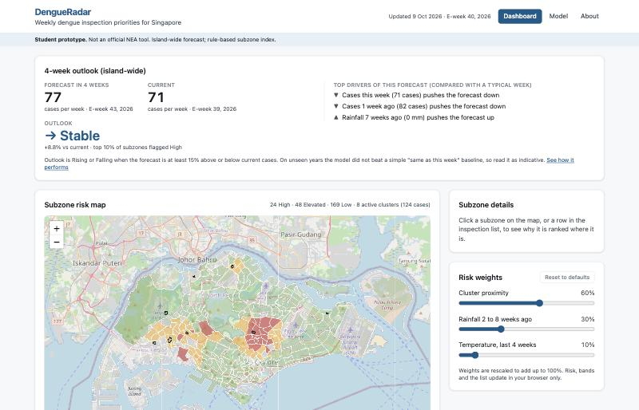
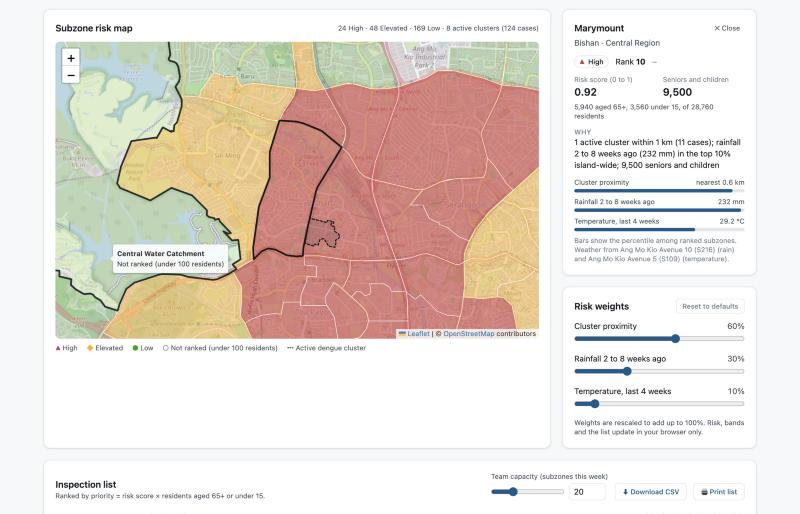
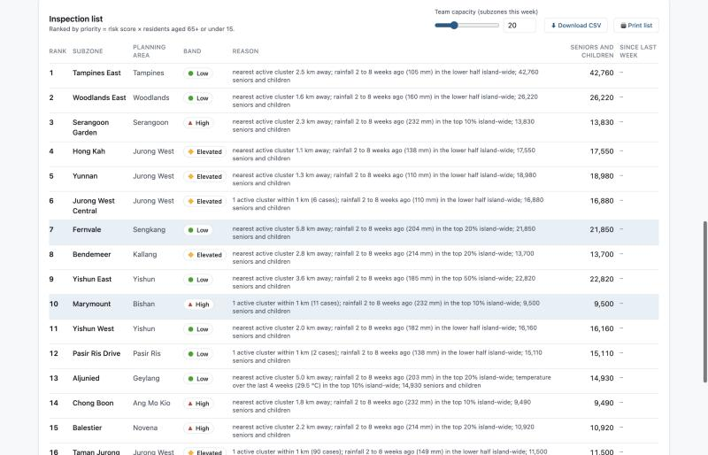
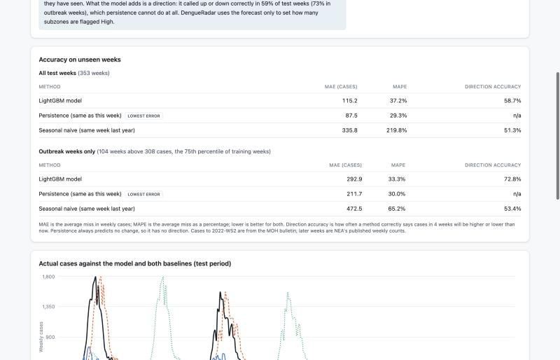

# DengueRadar

DengueRadar is a student hackathon prototype that helps Singapore's dengue inspection teams decide **where** to inspect each week, informed by a machine learning forecast of **how urgent** the next four weeks are. A LightGBM model forecasts island-wide weekly dengue cases 4 weeks ahead; a transparent rule-based index then ranks every residential URA subzone by proximity to active clusters, recent rainfall and temperature, weighted by the number of residents aged 65+ and under 15. It is a static site on GitHub Pages, refreshed weekly by GitHub Actions, with no backend.

**Live site:** https://advaitarunnair.github.io/dengueradar/

> **Not an official NEA tool.** The forecast is island-wide. The subzone ranking is a rule-based index, not a prediction, and has not been validated against future clusters.

## Screenshots

| Dashboard | Selected subzone |
|---|---|
|  |  |

| Inspection list | Model page |
|---|---|
|  |  |

## The problem

Inspection teams have limited hours. Active clusters show where transmission is happening now, but not which nearby neighbourhoods to check next or how much effort the coming month deserves. DengueRadar gives NEA vector control officers, operations planners and town councils a weekly shortlist sized to their capacity.

## How it works

### 1. ML forecast ("when")

- Target: `log1p(weekly dengue cases)` 4 weeks ahead, island-wide (Dengue Fever + Dengue Haemorrhagic Fever).
- Features at week *t* (only information available at the end of week *t*): log cases at lags 0 to 3, 4-week mean and slope, Changi rainfall and mean temperature at lags 2 to 8 weeks and their 7-week aggregates, week of year as sin/cos.
- Time-based split: train on target weeks up to 2019 (last 52 weeks for early stopping and light tuning), test on 2020 onwards.
- Outlook: **Rising** if the forecast is at least 15% above current weekly cases, **Falling** if at least 15% below, otherwise **Stable**.

### 2. Subzone ranking ("where")

For each subzone with at least 100 residents:

```
spread   = sum over active clusters of cases × exp(−d_km / 1.0)      d = centroid to cluster polygon, SVY21
rain     = rainfall total from day −56 to day −14 at the nearest station with data
temp     = mean temperature over the last 28 days at the nearest station with data
(each converted to a 0 to 1 percentile rank across subzones)

risk     = 0.6 × spread + 0.3 × rain + 0.1 × temp
priority = risk × (residents aged 65+ and under 15)
```

The forecast sets how wide the net is: when the outlook is Rising the top 20% by risk are **High** and the next 20% **Elevated**; when Stable or Falling the top 10% are High and the next 20% Elevated. The inspection list is sorted by priority.

## Model results

Test set: 353 unseen target weeks, 2020-W01 to 2026-W39 (trained on 2012-W08 to 2019-W52, 410 weeks). Copied from `web/public/data/model_eval.json`.

**All test weeks, n = 353**

| Method | MAE (cases) | MAPE | Direction accuracy |
|---|---:|---:|---:|
| LightGBM model | 115.2 | 37.2% | 58.7% |
| Persistence (cases at t) | 87.5 | 29.3% | n/a |
| Seasonal naive (same week last year) | 335.8 | 219.8% | 51.3% |

**Outbreak weeks (above 308 cases, the 75th percentile of training weeks), n = 104**

| Method | MAE (cases) | MAPE | Direction accuracy |
|---|---:|---:|---:|
| LightGBM model | 292.9 | 33.3% | 72.8% |
| Persistence (cases at t) | 211.7 | 30.0% | n/a |
| Seasonal naive (same week last year) | 472.5 | 65.2% | 53.4% |

**Honest summary:** the model did not beat persistence on unseen weeks (higher MAE and MAPE, overall and in outbreak weeks), although it was far better than seasonal naive. The 2020 and 2022 outbreaks peaked at about twice the highest level in the training years, which tree models cannot extrapolate to; what the model adds over persistence is a direction call, correct in about 59% of test weeks and 73% of outbreak weeks.

## Data sources and licences

| Data | Source | Licence |
|---|---|---|
| Dengue Clusters (GeoJSON) | NEA via [data.gov.sg](https://data.gov.sg/datasets/d_dbfabf16158d1b0e1c420627c0819168/view) | Singapore Open Data Licence |
| Weekly Infectious Disease Bulletin Cases (2012 to 2022) | MOH via [data.gov.sg](https://data.gov.sg/datasets/d_ca168b2cb763640d72c4600a68f9909e/view) | Singapore Open Data Licence |
| Weekly dengue cases, 2023 onwards | [NEA Dengue Cases page](https://www.nea.gov.sg/dengue-zika/dengue/dengue-cases) | NEA website terms of use |
| Real-time rainfall and air temperature by station | NEA via [data.gov.sg](https://data.gov.sg/collections/1459/view) | Singapore Open Data Licence |
| Historical daily records, Changi (S24) | [Meteorological Service Singapore](http://www.weather.gov.sg/climate-historical-daily/) | MSS terms of use |
| Master Plan 2019 Subzone Boundary (No Sea) | URA via [data.gov.sg](https://data.gov.sg/datasets/d_8594ae9ff96d0c708bc2af633048edfb/view) | Singapore Open Data Licence |
| Resident population by subzone, age group and sex (GHS 2025) | [SingStat Table Builder C020123](https://tablebuilder.singstat.gov.sg/table/CT/C020123) | Singapore Open Data Licence |

All dataset IDs and URLs are recorded in `config.yaml` after being confirmed through the APIs. No data on the site is simulated.

## Run locally

```bash
python3 -m venv .venv && .venv/bin/pip install -r requirements.txt
.venv/bin/python scripts/download_static.py   # once: boundaries + population
.venv/bin/python scripts/train_model.py       # once: train and evaluate the forecast
.venv/bin/python scripts/build_scores.py      # weekly: clusters, weather, forecast, scores
.venv/bin/pytest -q

cd web
npm install
npm run dev        # http://localhost:5173/dengueradar/
npm run build
```

Set `DATA_GOV_SG_API_KEY` to send an API key to data.gov.sg (optional; raises rate limits).

## Weekly automation

`.github/workflows/refresh-and-deploy.yml` runs every Monday 06:00 SGT (and on manual dispatch). The **refresh** job runs the tests and `build_scores.py`, then commits changed data as `github-actions[bot]` ("Weekly data refresh YYYY-WW"). The **deploy** job builds `web/` and publishes it to GitHub Pages. A push to `main` runs the deploy job only.

Daily station weather is cached in `data/cache/weather`, so each weekly run fetches only the 7 new days. Each run saves a snapshot to `data/history/YYYY-WW.json`, which the next run uses for week-on-week rank changes.

## Limitations

- The forecast is island-wide only and did not beat the persistence baseline on unseen years (see results above).
- Serotype shifts and population immunity are not observed, so large outbreaks are under-predicted.
- The subzone index is rule-based with judgement weights and is not validated against where clusters appear later.
- Weather comes from limited stations: Changi for the forecast, nearest station with data for each subzone.
- Weekly cases from 2023 come from NEA's web page, which can be revised and differs slightly from the MOH bulletin (mean absolute difference of about 9 cases a week over 2022, where both exist).
- Vector control interventions (for example Project Wolbachia) are not modelled.

## Team

| Role | Name |
|---|---|
| Data and ML | _to be added_ |
| Frontend | _to be added_ |
| Domain research and presentation | _to be added_ |
